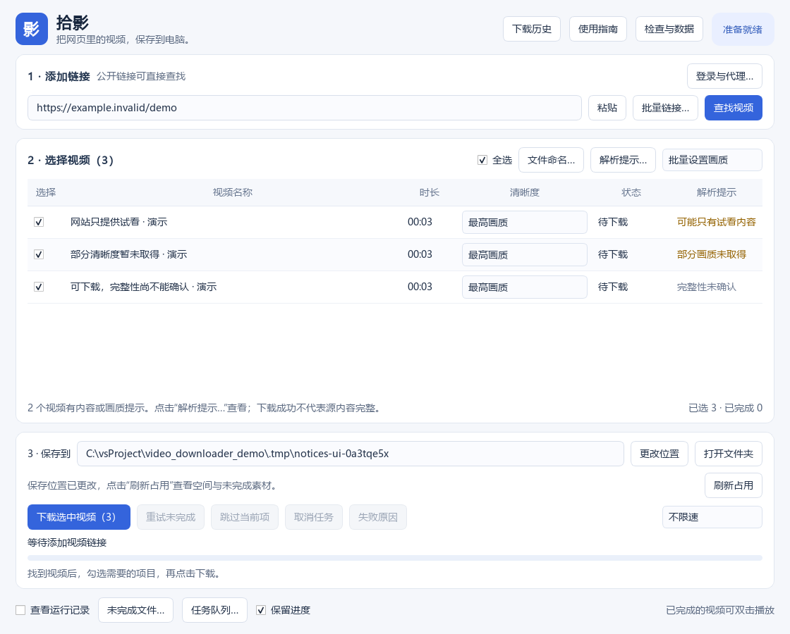

# GPTcreateWorld · 作品集

这里收录个人开发的实用工具与应用。每个作品独立存放，附有简体中文介绍、安装步骤和使用说明。

## 当前作品

| 作品 | 用途 | 技术与平台 | 状态 |
| --- | --- | --- | --- |
| [拾影 · 视频下载器](apps/shiying/) | 粘贴视频网页地址，选择视频和清晰度，保存为本地 MP4 | Python、PySide6、yt-dlp、FFmpeg；主要面向 Windows | 可运行的桌面演示版 |

### 拾影能做什么？

查找网页中可识别的视频，按需选择清晰度和保存位置，显示下载进度、速度和剩余时间；提供失败重试、下载历史、任务恢复、登录信息导入、环境检查及解析引擎更新。

**从这里开始：[拾影的安装与使用说明](apps/shiying/README.md)。**



## 仓库结构

```text
apps/
  shiying/       拾影视频下载器：源码、测试、说明与示例界面
```

后续作品可继续添加到 `apps/` 下的独立目录，使用各自的依赖环境，避免相互影响。

仓库仅包含项目源码、合成素材测试程序和示例界面，不包含下载视频、浏览器登录凭据、本机历史或 Python 虚拟环境。
