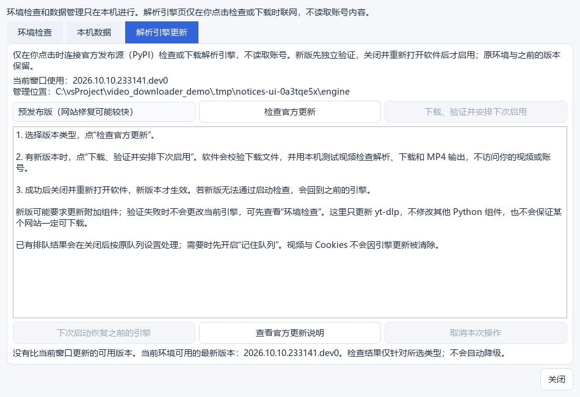

# 拾影 0.1.0 · 视频下载器

**粘贴网页地址，选好视频与清晰度，把内容保存为本地 MP4。**

拾影是一款使用 Python 开发的中文桌面工具，结合 PySide6 图形界面、yt-dlp 网站解析和 FFmpeg 视频处理，让常见下载操作可以在窗口中完成。主要面向 Windows，提供源码与 Windows x64 免安装包。

**直接使用：[前往 GitHub Releases 下载 Windows 免安装版](https://github.com/sjy1107/GPTcreateWorld/releases)。** 选择名称包含 `Windows-x64-Portable.zip` 的附件，完整解压后进入 `Shiying` 文件夹，双击“拾影.exe”，无需安装 Python。详细步骤见[下载与启动说明](DOWNLOAD.md)。

当前没有 Windows 代码签名证书，程序未签名，部分电脑可能拦截。0.1.0 已修复打包时混入不兼容 ICU DLL 导致的启动错误：296 项源码测试通过，并在没有外部 Python、FFmpeg 或 Deno 的 PATH 下，通过真实 EXE 的界面启动、四格式本地资源下载与 MP4 完整解码、后台引擎验证。尚未在另一台 Windows 10 电脑验收。GitHub 自动提供的 **Source code** 和 **Code → Download ZIP** 是源码，需要自行准备 Python 环境。


## 主要功能

| 功能 | 使用时能做什么 |
| --- | --- |
| 网页视频查找 | 识别受支持的视频播放页、帖子或播放列表，并补充查找普通网页中可识别的嵌入视频与媒体链接 |
| 批量添加 | 从网址或分享文字中提取链接，确认后批量查找；单次最多 20 个链接、50 个视频 |
| 画质选择 | 每个视频单独选择实际可用的清晰度；有足够信息时显示预计素材大小 |
| 统一保存 MP4 | 处理 MP4、WebM、HLS、DASH 等来源；合并分离音视频，必要时转换为常见的 H.264 / AAC MP4 |
| 下载状态 | 显示进度、实时速度、预计剩余时间，以及合并和转码阶段的状态 |
| 错误处理 | 区分链接失效、403 / 404 / 429、登录要求、超时、代理、磁盘和转换问题，给出处理建议 |
| 重试与取消 | 支持有限自动重试、跳过当前项、取消全部，以及重试未完成任务；部分过期媒体地址会刷新一次 |
| 进度与队列 | 普通 HTTP 下载在可可靠核对资源时支持续传；可选择记住未完成任务，重启后重新解析并恢复列表 |
| 文件与历史 | 选择保存位置、自定义文件名、重名保护、下载历史搜索、已移动文件重新定位、未完成素材清理 |
| 登录与代理 | 公开资源直接使用；需要时主动读取浏览器登录状态，或导入 Netscape / 常见 JSON Cookies；支持代理设置 |
| 内容提示 | 对明确的试看、缺失画质和观看条件显示逐视频说明；不能确定时显示“完整性未确认” |
| 环境与更新 | 启动环境检查、本机数据管理、手动检查解析引擎更新；独立验证后安排下次启动启用，支持恢复旧版本 |
| 内置指引 | 简体中文使用指南、关键词搜索、悬浮说明及对应操作入口 |

## 第一次安装

### 1. 获取项目

在仓库页面点击 **Code → Download ZIP**，解压后进入 `apps/shiying` 文件夹。也可以使用 Git 克隆整个仓库后进入这个目录。

### 2. 准备 Python

推荐安装 **Python 3.12（64 位）**。如果使用 Anaconda，也可以先创建一个 Python 3.12 环境。安装后，在 `apps/shiying` 文件夹中打开终端，确认 `python --version` 显示正确版本。

### 3. 安装依赖

在该目录的 PowerShell 或 VSCode 终端依次运行：

```powershell
python -m venv .venv
.\.venv\Scripts\python.exe -m pip install -r requirements.txt
```

这会在项目内创建独立环境，不需要手动激活，也不会把视频放进 Python 环境。

Windows 版 `imageio-ffmpeg` 通常自带 FFmpeg；程序也可使用系统已安装的 FFmpeg。不要用 `pip install ffmpeg` 代替 FFmpeg 程序。YouTube 的部分解析还需要 JavaScript 运行环境，例如 Node.js 22+；环境检查会提示相关情况。

### 4. 打开应用

双击 **`start.bat`**，或执行：

```powershell
.\.venv\Scripts\python.exe main.py
```

首次下载源码不会包含 `.venv`，所以必须先安装依赖。启动时会检查必要组件和保存位置，并给出修复提示。

## 保存第一个视频

1. 在浏览器中打开目标视频，复制完整网页地址，也可以复制包含网址的分享文字。
2. 粘贴到拾影，点击 **查找视频**。多个链接会先让你确认。
3. 勾选想保存的视频，在每行中选择清晰度，并查看 **解析提示**。
4. 确认 **保存位置**，点击 **下载选中视频**。
5. 完成后点击 **打开文件夹**，或双击已完成的视频行播放。

默认保存到应用目录内的 `downloads` 文件夹，可随时更改。选择 720p 表示获取不超过该高度的最佳可用来源，不会将低清视频放大冒充高清。预计大小通常是下载素材的估计值，转码后的 MP4 大小可能不同。

有疑问时按 **F1**，或点击 **使用指南**。可以搜索“登录”“空间”“续传”等词，查看说明后直接进入相关功能。

## 常见网站与兼容范围

主要复用 [yt-dlp](https://github.com/yt-dlp/yt-dlp) 的站点解析器，同时补充普通网页资源识别。可尝试哔哩哔哩、抖音、X / Twitter、Instagram、YouTube、Telegram 公开消息，以及 yt-dlp 支持的其他可访问页面。

**接入解析器不代表整站、全部视频或全部清晰度都能下载。** 登录条件、账号权限、网络、地区、反机器人检查和网站改版都可能影响结果。普通网页只扫描有限范围的可识别资源，不执行网页脚本、不遍历整个网站。当前不处理正在直播的流。

只保存自己有权保存的内容。软件不会解密 DRM，也不会增加账号的会员、付费或私密内容权限。

## 需要登录的视频如何使用？

公开链接先直接查找，无需添加登录信息。确实需要登录时：

1. 在浏览器中登录，并确认自己的账号能播放这个具体视频。
2. 在拾影粘贴网址，打开 **登录与代理**。
3. 选择浏览器，点击 **读取当前网站登录状态**；这里指拾影中粘贴网址的网站。
4. 读取成功后重新查找视频。读取成功仅表示取得访问记录，不等于已验证全部观看权限。

Edge / Chrome 可能因浏览器占用或 Windows 加密方式而读取失败。可使用应用内导入向导，导入自己导出的 **Netscape 文本或常见 JSON Cookies 文件**，也支持主动从剪贴板导入。不要直接把浏览器的 `Cookies` 数据库当作文本文件导入。

复制网页地址通常不会带上登录状态。Cookies 相当于登录凭据，**不要分享、截图暴露或上传到仓库**。更详细的操作、浏览器限制和导出流程见应用内指引及 [登录帮助](LOGIN_HELP.md)。

## 下载失败时

- **404 / 链接失效**：回到网站确认页面仍然存在，复制新链接后重试。
- **403 / 拒绝访问 / 需要登录**：确认原网页能播放，再检查自己的登录状态、权限和网络。
- **429 / 请求过于频繁**：按提示等待，避免反复快速重试。
- **超时或代理错误**：确认网络和代理可用；本机测试地址应直连。
- **空间不足或路径无法写入**：更换保存位置或腾出空间，再重试未完成任务。
- **合并或转换失败**：在 **检查与数据 → 环境检查** 中检查 FFmpeg 和相关组件。

选中失败的视频，点击 **失败原因** 可查看解释与脱敏技术详情。先检查原因，再使用 **重试未完成**，已成功的视频无需重复下载。

## 本机数据和版本更新

**检查与数据** 集中提供环境检查、本机数据和解析引擎更新。历史、队列和设置保存在应用的本机目录；未完成素材可查看占用并确认清理，管理页不提供删除成品 MP4 的操作。

更新需要主动点击检查。新引擎在独立目录验证，成功后安排下次启动启用；当前窗口继续使用原引擎。可取消安排、恢复之前版本，启动验证失败时会尝试回退。新版需要当前环境没有的其他组件时，会提示原因并保留原环境。



## 不联网也能体验的测试页

完成安装后，双击 **`start_test_page.bat`**，保持测试窗口运行，再在拾影中查找：

```text
http://127.0.0.1:8765/index.html
```

测试视频由 FFmpeg 在本机生成，是短暂的彩色图案和声音，这是正常的测试素材。关闭测试窗口后，该网址就无法访问了。

## 开发与验证

```powershell
.\.venv\Scripts\python.exe -m unittest discover -s tests -t . -q
.\.venv\Scripts\python.exe -m tests.integration_demo
```

0.1.0 完整源码回归共有 **296 项通过**。覆盖解析、画质、真实本机下载和 MP4 处理、续传、存储、历史、Cookies 范围、错误提示、Qt 界面、引擎更新与恢复，以及便携路径和文件夹移动。测试使用合成素材和本机 HTTP 服务，不依赖外部视频网站的稳定性，也不读取真实账号资料。运行时请让 `localhost` / `127.0.0.1` 直连。真实冻结 EXE 的启动、四格式本地下载与 MP4 完整解码、后台 worker 验证通过；打包更新另有 5 项保留数据测试。本轮成品验证未覆盖外站可用性或引擎联网更新与恢复全流程。

```text
main.py             启动入口
start.bat           Windows 双击启动
video_demo/         界面、解析下载、视频处理与本机管理
tests/              自动化测试与本地测试页
docs/               示例界面截图
requirements.txt    当前项目的直接依赖版本
LOGIN_HELP.md       登录状态与 Cookies 操作说明
```

## 使用的项目

- [PySide6 / Qt for Python](https://doc.qt.io/qtforpython/)：桌面图形界面。
- [yt-dlp](https://github.com/yt-dlp/yt-dlp)：站点解析、格式选择与下载。
- [FFmpeg](https://ffmpeg.org/) 和 [imageio-ffmpeg](https://github.com/imageio/imageio-ffmpeg)：合并、封装、编码转换与媒体检查。
- Requests、Beautiful Soup：网页请求与静态资源识别。

本仓库不附带第三方依赖的安装文件；这些项目分别适用其各自的许可。
